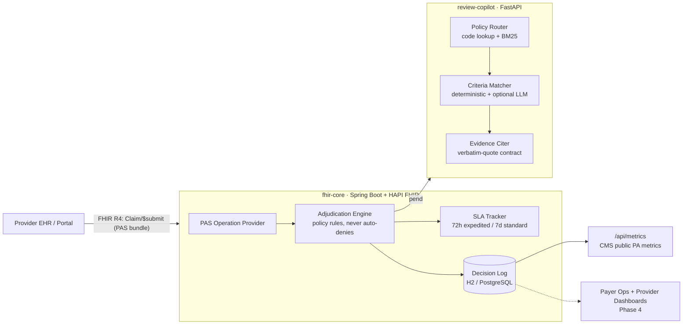

# ClearAuth

**Open-source CMS-0057-F Prior Authorization platform.** A FHIR-native reference implementation of the prior-auth infrastructure every US payer must operate by **January 1, 2027** — HL7 Da Vinci PAS-style intake, auditable rules-based adjudication, SLA enforcement, and the CMS-mandated public metrics.

> Why this exists: per [CMS-0057-F](https://www.cms.gov/newsroom/fact-sheets/cms-interoperability-prior-authorization-final-rule-cms-0057-f), impacted payers must expose a Prior Authorization API, decide expedited requests in **72 hours** and standard requests in **7 days**, give specific denial reasons, and publicly report approval/denial metrics. Commercial implementations cost $1M–$5M. This is the open one.

## Architecture



**Design stance:** the engine **approves or pends — it never auto-denies**. Denials require human clinical review by design (the legally defensible posture after the industry's auto-denial lawsuits).

## Quickstart

```bash
# Option A: Docker
docker compose up --build

# Option B: local (Java 17+)
cd services/fhir-core && mvn spring-boot:run
```

Submit a prior-auth request:

```bash
./scripts/submit-sample.sh                     # MRI brain + migraine dx -> Approved
./scripts/submit-sample.sh samples/pa-request-pend.json   # unclassified drug -> Pended
curl -s localhost:8080/api/metrics | jq        # CMS-style PA metrics
```

## What works today (Phase 1)

| Capability | CMS-0057-F requirement | Status |
|---|---|---|
| `POST /fhir/Claim/$submit` accepting a PAS request bundle | Prior Authorization API | ✅ |
| Deterministic policy-rules adjudication with cited policy IDs | Specific reason for decisions | ✅ |
| SLA clock per request (72h expedited / 7d standard) | Decision timeframes | ✅ |
| Decision log + `/api/metrics` (approval rate, turnaround) | Public PA metrics reporting | ✅ |
| Synthetic sample bundles, zero PHI | — | ✅ |
| Review copilot: policy retrieval (BM25 from scratch) + criteria matching with cited evidence | Specific reason for decisions | ✅ |
| Eval harness gating CI: accuracy + evidence-contract (no fabricated citations) | — | ✅ |
| Optional LLM paraphrase matching (Claude) with verbatim-quote verification | — | ✅ |

## Roadmap

- [x] **Phase 1 — FHIR core:** PAS `$submit` happy path, rules engine, SLA tracking, metrics
- [x] **Phase 2 — Clinical review copilot:** retrieval over medical-necessity policies, evidence-cited approve/pend recommendations, eval harness, optional LLM matching
- [ ] **Phase 3 — Interop depth:** Da Vinci CRD hooks + DTR questionnaires, X12 278 ↔ FHIR mapper, Inferno conformance runs
- [ ] **Phase 4 — Dashboards:** provider status portal + payer ops queue (React/TS)
- [ ] **Phase 5 — Scale:** PostgreSQL, event sourcing, 10K req/hr load test

## Repo layout

```
services/fhir-core/        Spring Boot 3 + HAPI FHIR server (Java 17)
services/review-copilot/   FastAPI clinical-review recommendation service (Python 3.12)
samples/                   Synthetic PAS request bundles (no PHI)
scripts/                   Demo scripts
```

## Review copilot

The copilot answers one question: *does the submitted clinical evidence satisfy
the governing medical-necessity policy?* It recommends **approve or pend — never
deny**; denial is reserved for a licensed human reviewer.

```bash
curl -s localhost:8090/review -H "Content-Type: application/json" -d '{
  "procedure_code": "27447",
  "diagnosis_codes": ["M17.11"],
  "clinical_note": "Kellgren-Lawrence grade 4. Failed 3 months of physical therapy and corticosteroid injection."
}' | jq
```

Every citation is a **verbatim substring** of the clinical note or a structured
diagnosis match — the eval harness (`python eval/run_eval.py`) fails CI on any
fabricated evidence. Setting `ANTHROPIC_API_KEY` enables LLM paraphrase matching;
the model's quotes are verified against the note before being trusted, so the
LLM can widen recall but cannot hallucinate evidence.

When `fhir-core` pends a request and `CLEARAUTH_REVIEWCOPILOT_URL` is set, the
copilot's recommendation is attached to the `ClaimResponse` as a process note
for the human reviewer.

## Compliance & data

All patient data in this repo is **synthetic**. Policy rules are illustrative, authored for this project — not payer proprietary content. Apache-2.0 licensed.
