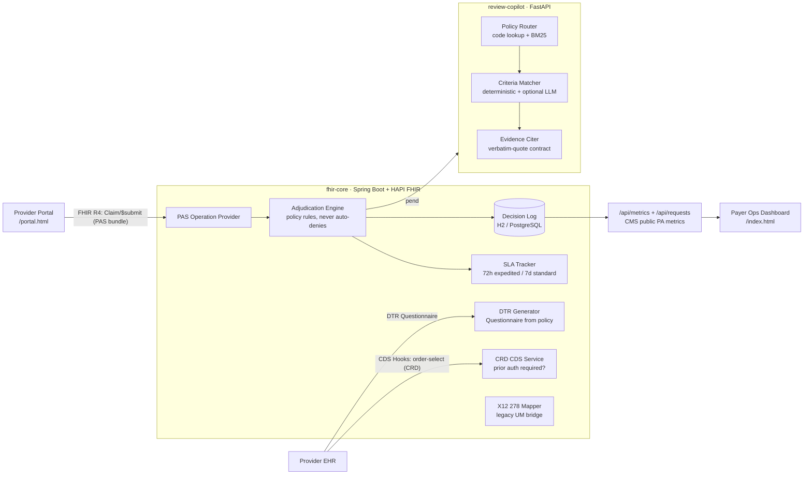

# ClearAuth

**Open-source CMS-0057-F Prior Authorization platform.** A FHIR-native reference implementation of the prior-auth infrastructure every US payer must operate by **January 1, 2027** — HL7 Da Vinci PAS-style intake, auditable rules-based adjudication, SLA enforcement, and the CMS-mandated public metrics.

> Why this exists: per [CMS-0057-F](https://www.cms.gov/newsroom/fact-sheets/cms-interoperability-prior-authorization-final-rule-cms-0057-f), impacted payers must expose a Prior Authorization API, decide expedited requests in **72 hours** and standard requests in **7 days**, give specific denial reasons, and publicly report approval/denial metrics. Commercial implementations cost $1M–$5M. This is the open one.

## Architecture



**Design stance:** the engine **approves or pends — it never auto-denies**. Denials require human clinical review by design (the legally defensible posture after the industry's auto-denial lawsuits).

## Quickstart

```bash
# Option A: Docker
docker compose up --build

# Option B: local (Java 17+)
cd services/fhir-core && mvn spring-boot:run
```

Then open **http://localhost:8080/portal.html** (provider portal) and
**http://localhost:8080/index.html** (payer ops dashboard), or use the CLI:

```bash
./scripts/submit-sample.sh                     # MRI brain + migraine dx -> Approved
./scripts/submit-sample.sh samples/pa-request-pend.json   # unclassified drug -> Pended
curl -s localhost:8080/api/metrics | jq        # CMS-style PA metrics
curl -s localhost:8080/cds-services | jq       # CRD discovery (CDS Hooks)
curl -s localhost:8080/api/dtr/questionnaire/70551 | jq   # DTR questionnaire
curl -s -X POST localhost:8080/api/x12/278/request \
  -H "Content-Type: application/fhir+json" \
  --data @samples/pa-request-approve.json      # FHIR -> X12 278
```

Production-style stack (PostgreSQL, API key, restart policies):

```bash
cp .env.example .env   # set DB_PASSWORD (and optionally CLEARAUTH_APIKEY, ANTHROPIC_API_KEY)
docker compose -f docker-compose.prod.yml up --build -d
python3 scripts/loadtest.py --requests 1000 --concurrency 50
```

See [SECURITY.md](SECURITY.md) for the production checklist and
[CONTRIBUTING.md](CONTRIBUTING.md) for dev setup.

## What works today (Phase 1)

| Capability | CMS-0057-F requirement | Status |
|---|---|---|
| `POST /fhir/Claim/$submit` accepting a PAS request bundle | Prior Authorization API | ✅ |
| Deterministic policy-rules adjudication with cited policy IDs | Specific reason for decisions | ✅ |
| SLA clock per request (72h expedited / 7d standard) | Decision timeframes | ✅ |
| Decision log + `/api/metrics` (approval rate, turnaround) | Public PA metrics reporting | ✅ |
| Synthetic sample bundles, zero PHI | — | ✅ |
| Review copilot: policy retrieval (BM25 from scratch) + criteria matching with cited evidence | Specific reason for decisions | ✅ |
| Eval harness gating CI: accuracy + evidence-contract (no fabricated citations) | — | ✅ |
| Optional LLM paraphrase matching (Claude) with verbatim-quote verification | — | ✅ |
| CRD: CDS Hooks `order-select` service answering "is prior auth required?" | Coverage requirements discovery | ✅ |
| DTR: FHIR Questionnaire generated from the governing policy; answers feed adjudication | Documentation requirements | ✅ |
| X12 278 request/response mapping for legacy UM systems | — | ✅ |
| Provider portal + payer ops dashboard (SLA queue, decision mix, live metrics) | Transparency | ✅ |
| PostgreSQL profile, actuator health, optional API-key gate, load-test script | — | ✅ |

## Roadmap

- [x] **Phase 1 — FHIR core:** PAS `$submit` happy path, rules engine, SLA tracking, metrics
- [x] **Phase 2 — Clinical review copilot:** retrieval over medical-necessity policies, evidence-cited approve/pend recommendations, eval harness, optional LLM matching
- [x] **Phase 3 — Interop depth:** Da Vinci CRD hooks (CDS Hooks `order-select`), DTR questionnaire generation, simplified X12 278 mapper, FHIR CapabilityStatement
- [x] **Phase 4 — Dashboards:** provider portal (`/portal.html`) + payer ops queue with SLA alerts (`/index.html`), zero-build static SPA served by fhir-core
- [x] **Phase 5 — Production hardening:** PostgreSQL profile + prod compose, actuator health, optional API-key gate, load-test script

**Next up:** Inferno/Touchstone conformance runs against the Da Vinci PAS test kit; OAuth2/SMART-on-FHIR gateway; event-sourced decision log.

## Repo layout

```
services/fhir-core/        Spring Boot 3 + HAPI FHIR server (Java 17)
services/review-copilot/   FastAPI clinical-review recommendation service (Python 3.12)
samples/                   Synthetic PAS request bundles (no PHI)
scripts/                   Demo scripts
```

## Review copilot

The copilot answers one question: *does the submitted clinical evidence satisfy
the governing medical-necessity policy?* It recommends **approve or pend — never
deny**; denial is reserved for a licensed human reviewer.

```bash
curl -s localhost:8090/review -H "Content-Type: application/json" -d '{
  "procedure_code": "27447",
  "diagnosis_codes": ["M17.11"],
  "clinical_note": "Kellgren-Lawrence grade 4. Failed 3 months of physical therapy and corticosteroid injection."
}' | jq
```

Every citation is a **verbatim substring** of the clinical note or a structured
diagnosis match — the eval harness (`python eval/run_eval.py`) fails CI on any
fabricated evidence. Setting `ANTHROPIC_API_KEY` enables LLM paraphrase matching;
the model's quotes are verified against the note before being trusted, so the
LLM can widen recall but cannot hallucinate evidence.

When `fhir-core` pends a request and `CLEARAUTH_REVIEWCOPILOT_URL` is set, the
copilot's recommendation is attached to the `ClaimResponse` as a process note
for the human reviewer.

## How to contribute

Contributions are welcome — payer interop needs more open implementations, not fewer. See [CONTRIBUTING.md](CONTRIBUTING.md) for ground rules (never-deny invariant, evidence contract, synthetic data only). To get started:

1. **Star ⭐ this repo** so more payer engineers find it, and **fork it** to your account.
2. Clone your fork and create a feature branch:
   ```bash
   git clone https://github.com/<your-username>/ClearAuth.git
   cd ClearAuth
   git checkout -b feature/my-change
   ```
3. Set up and verify both services locally:
   ```bash
   cd services/fhir-core && mvn verify && cd ../..
   cd services/review-copilot && pip install -r requirements-dev.txt
   python -m pytest tests/ -q && python eval/run_eval.py
   ```
4. Make your change. Add or update tests — and eval cases if you touch matching logic (90% accuracy gate).
5. Run the full stack once to smoke-test: `docker compose up --build`, then submit a request from `http://localhost:8080/portal.html`.
6. Commit with a clear message, push to your fork, and open a pull request describing **what** changed and **why**. Both CI jobs must be green.
7. Good first issues: new medical-necessity policies (`services/review-copilot/app/policies/`), more eval cases, additional X12 segments, dashboard improvements.

## Compliance & data

All patient data in this repo is **synthetic**. Policy rules are illustrative, authored for this project — not payer proprietary content. Apache-2.0 licensed.
